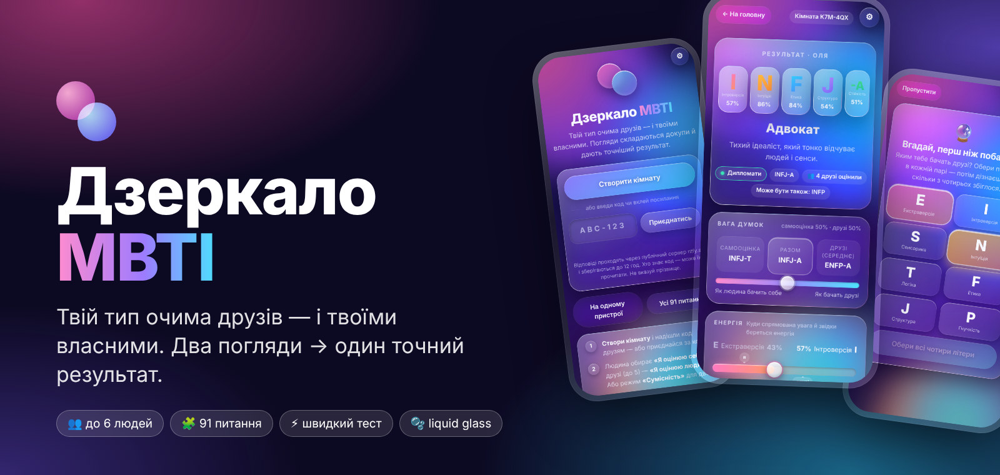
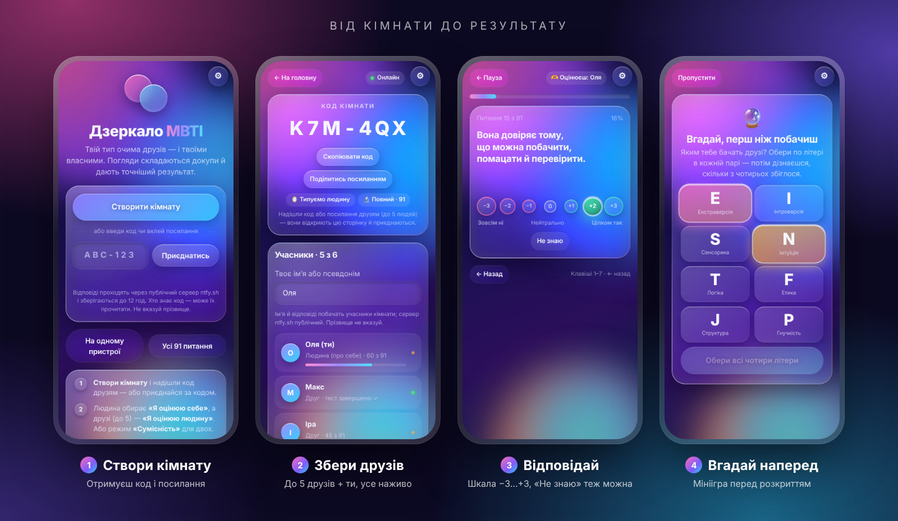
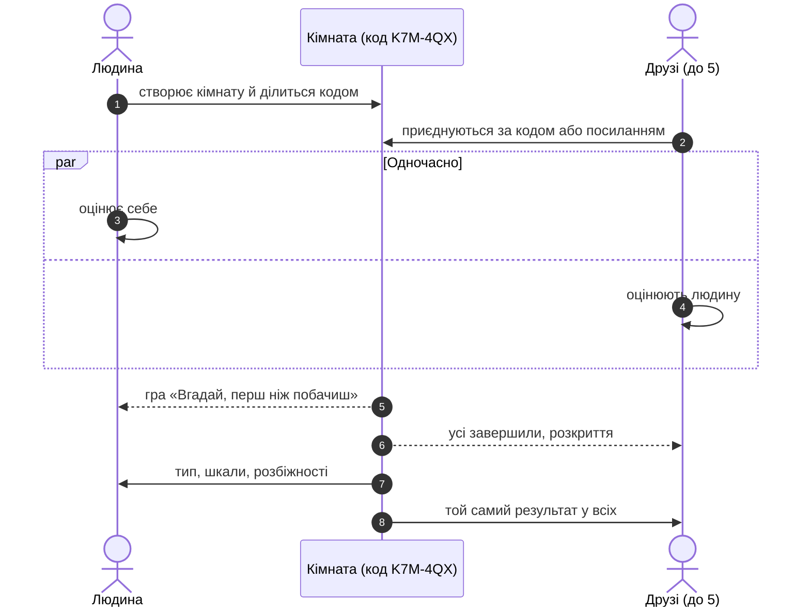
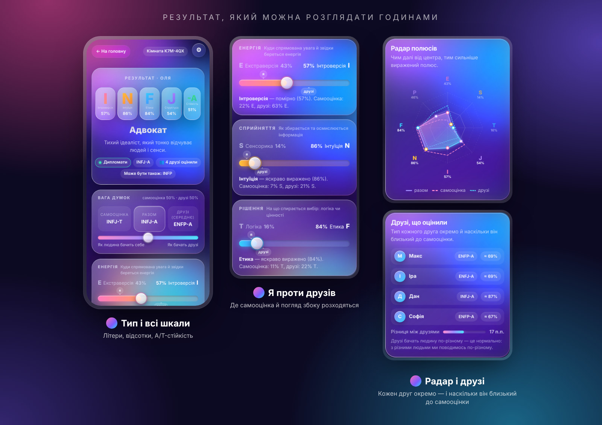
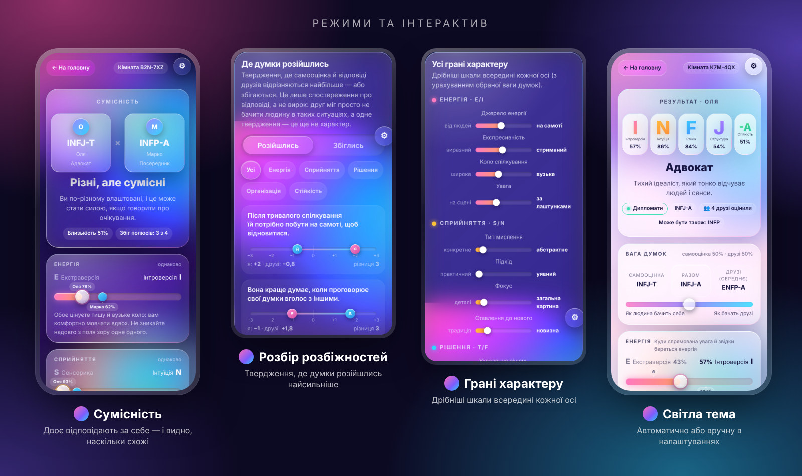
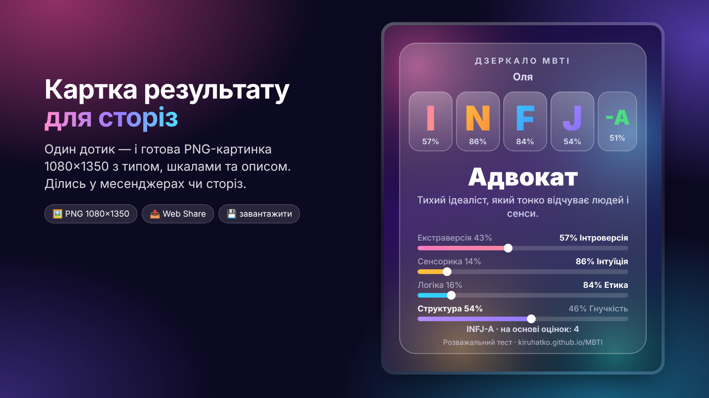
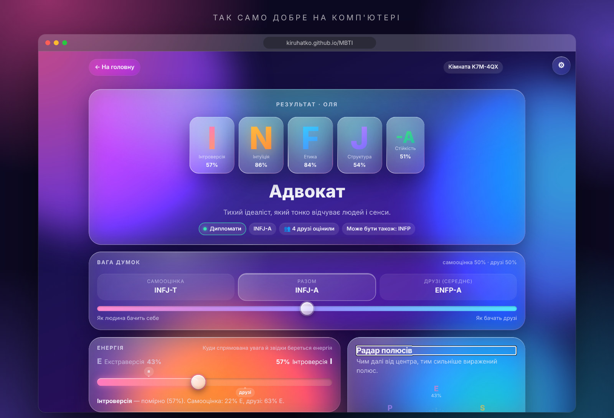

 

# Дзеркало MBTI

**Ти бачиш себе одним. Друзі — іншим. Дзеркало складає обидва погляди докупи.**

 

  

 

## ✨ Ідея

Тест особистості, який питає не лише **тебе**, а й **тих, хто тебе знає**.

Створи кімнату, надішли друзям код, і кожен відповідає про тебе, а ти — про себе.
Дзеркало зводить ці погляди в один результат: **тип, усі шкали, слабкі місця самооцінки** і те, де друзі бачать тебе не так, як ти сам.

 

## 🚀 Від кімнати до результату

 

## 📊 Результат, який можна розглядати годинами

| | |
|---|---|
| **16 типів** | з українськими назвами й описами, у чотирьох групах: Аналітики, Дипломати, Охоронці, Дослідники |
| **4 шкали + стійкість** | Енергія · Сприйняття · Рішення · Організація, а ще окрема шкала A/T (стресостійкість, самооцінка, емоційний фон) |
| **19 граней** | дрібніші шкали всередині кожної осі: від «Джерела енергії» до «Дисципліни» |
| **Вага думок** | повзунок «самооцінка ⇄ друзі»: дивись тип лише очима людини, лише очима друзів або посередині |
| **Радар полюсів** | форма особистості одним поглядом: разом, самооцінка, друзі |
| **Когнітивні функції** | типовий «стек» для отриманого типу |
| **Погранична зона** | якщо шкала майже порівну, показує й сусідній тип («Може бути також: INFP») |
| **Узгодженість друзів** | наскільки друзі збігаються між собою. Окремі відповіді не показуються, лише тип кожного друга |

 

## 🎛️ Режими та інтерактив

<table>
<tr>
<td width="50%" valign="top">

### 🪞 Типуємо людину
Людина відповідає про себе, друзі (до 5) про неї. Порівнюються погляди, а різниця між ними і є головним відкриттям.

</td>
<td width="50%" valign="top">

### 🤝 Сумісність
Двоє відповідають кожен про себе. Дзеркало показує, наскільки вони схожі, на яких шкалах збігаються, а де тягнуть у різні боки.

</td>
</tr>
<tr>
<td valign="top">

### 🔬 Повний · 91 питання
Найточніший результат, приблизно 15 хвилин.

</td>
<td valign="top">

### ⚡ Швидкий · 30 питань
Близько 4 хвилин. Результат орієнтовний, і Дзеркало чесно це позначає.

</td>
</tr>
<tr>
<td valign="top">

### 👥 Кімната з кодом
Кожен на своєму телефоні, склад і прогрес видно наживо. Якщо хтось довідповів пізніше, результат оновлюється одним дотиком.

</td>
<td valign="top">

### 📱 На одному пристрої
Телефон передається по колу: спершу людина, потім друг. Без кімнат і мережі.

</td>
</tr>
</table>

 

## 🎁 Дрібниці, які роблять його живим

| | |
|---|---|
| 🔮 **«Вгадай, перш ніж побачиш»** | Обери літери, якими тебе, на твою думку, бачать друзі, а тоді дізнайся, скільки з чотирьох збіглося |
| 🎬 **Розкриття** | Анімація з конфеті, коли всі закінчили |
| 🧭 **Де думки розійшлись** | Твердження, де самооцінка й погляд друзів розійшлись найсильніше (або збіглись). Це спостереження, а не вирок |
| 🤷 **«Не знаю»** | Друг може чесно пропустити питання, воно не псує результат |
| 🖼️ **Картка результату** | Готова PNG 1080×1350 для сторіз і месенджерів |
| 🌗 **Світла й темна теми** | Автоматично або вручну; є налаштування легких ефектів і вібрації, а також режим зі зменшеним рухом |
| ⌨️ **Клавіші 1–7** | Увесь тест можна пройти з клавіатури |
| 🕘 **Мої сесії** | Закрив вкладку посеред тесту? Повернися до кімнати з того ж місця |
| 🔗 **Посилання-запрошення** | Скинув посилання замість коду, і друг відкриває його одразу в кімнаті |

 

<table>
<tr>
<td width="58%" valign="middle">

</td>
<td width="42%" valign="middle">

### 🖼️ Картка для сторіз

Один дотик, і готовий кадр із типом, відсотками й коротким описом.
Поділитись можна прямо з сайту або завантажити як PNG.

</td>
</tr>
</table>

 

## 💻 І на комп'ютері теж

 

## 🔒 Приватність

<b>Що відбувається з відповідями</b>

 

- Сайт це **один статичний HTML-файл**. Власного сервера, акаунтів, cookies і аналітики немає.
- Твої відповіді зберігаються лише **в браузері** (localStorage) на цьому пристрої.
- Щоб кімната працювала між телефонами, учасники обмінюються відповідями через публічний сервер [ntfy.sh](https://ntfy.sh): повідомлення зберігаються там приблизно 12 годин.
- Хто знає **код кімнати**, той технічно може прочитати її повідомлення. Передавай код лише тим, кого запрошуєш, а в імені не вказуй прізвище.
- Кожна вкладка браузера це окремий учасник, тож для друга потрібен його власний телефон або вкладка.
- У режимі «На одному пристрої» нічого нікуди не передається.

<b>Як рахується результат</b>

 

- Кожне твердження оцінюється за шкалою **−3 … +3** і тягне до одного з двох полюсів осі.
- Вісь = сума `відповідь × напрямок` ÷ (3 × кількість відповідей), що дає відсоток 0–100 %. Літера визначається знаком шкали, а біля нуля Дзеркало показує «сіру зону» й сусідній тип.
- Тип «разом» це зважене середнє самооцінки та середньої думки друзів (вагу обираєш сам). Розбіжність між самими друзями рахується окремо від розбіжності «ти ⇄ друзі».
- «Не знаю» не впливає на шкали. Швидкий тест використовує підмножину з 30 тверджень, тому відсотки там округлені, а граней немає.
- Склад тесту: 4 осі по 20 питань і 11 питань на шкалу A/T, разом 91.

<b>Технічно</b>

 

- Чистий HTML + CSS + JS без залежностей, зовнішніх бібліотек і збирання на боці користувача.
- Дизайн «liquid glass»: `backdrop-filter`, конічний градієнт на рамках, відблиск за курсором. Враховано `prefers-reduced-motion` і `prefers-color-scheme`.
- Кімната це топік `dzerkalo-mbti-<код>` на ntfy.sh (`POST` і SSE з `since=all`). Протокол обмінюється знімками стану з версіями, тому дублікати й повторне завантаження не шкодять.
- Власний сервер ntfy можна підставити через `window.MBTI_RELAY = 'https://ntfy.example.com'` перед скриптом.

 

## ⚠️ Чесно про результат

Це **розважальний тест**, а не психологічна діагностика. MBTI описує вподобання, а не здібності чи долю, і двоє схожих людей можуть отримати різні типи. Найцікавіше тут не літери, а **різниця між тим, як бачиш себе ти й як бачать тебе інші**.

 

---

© 2026 **kiruhatko**. Усі права захищені. 
Користуватись сайтом можна вільно, але копіювати, змінювати чи публікувати його код, дизайн, тексти й питання без письмового дозволу автора заборонено. Подробиці в [LICENSE](LICENSE).

